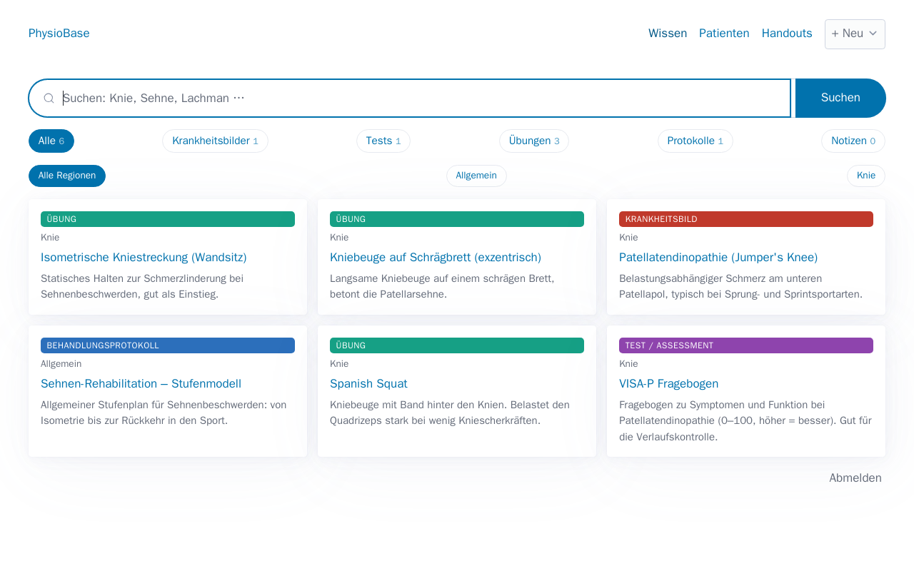

# PhysioBase

A self-hosted knowledge base and documentation tool for physiotherapy. It keeps
conditions, tests, exercises and treatment protocols in one searchable place,
links them to patients and their assessments (Befunde), and prints exercise
handouts and assessment reports.

One static Go binary, one SQLite file, server-rendered pages. The interface is
in German. JavaScript is only used for marking the body chart and a few
conveniences; everything else works without it.

> **▶ Live-Demo:** [physiobase.gpl-nas.de](https://physiobase.gpl-nas.de) –
> Zugang `admin` / `demo1234`. Alle Angaben werden **beim Abmelden gelöscht**.
> Besucher-Statistik zählt nur nach Zustimmung (Cookie-Banner).
>
> **📦 Image-Pulls:** 
>
> **💬 Feedback & Wünsche:** [feedback.gpl-nas.de](https://feedback.gpl-nas.de/feedback) –
> ohne Anmeldung, erscheint hier im Repo: [FEEDBACK.md](FEEDBACK.md).



> **🗺️ Roadmap:** planned features, non-goals and the release process are in [ROADMAP.md](ROADMAP.md).

## Features

- **Knowledge base**: conditions, tests/assessments, exercises, treatment
  protocols and notes. Markdown content, tags, body regions, images, videos
  and PDFs, source references, and links between entries.
- **Search**: full text (SQLite FTS5) with prefix matching and diacritics
  folding: `knie` finds *Kniegelenk*, `ubung` finds *Übung*.
- **Exercise handouts**: pick exercises, set dosage and a personal note,
  reorder, copy as a template, print or save as PDF (A4 print view).
- **Patients**: assessments, treatment log, documents, linked knowledge
  entries, home programmes and summaries on one page.
- **Patient documents**: scanned PDFs and photos (doctor's letters,
  prescriptions, imaging, progress photos) with title, category and date.
  Several files per upload; phones and tablets can take the photo directly.
  Files are only served to a logged-in user, never cached, and deleted
  together with the patient.
- **Assessment form (Befund)**: ICF-oriented and evidence-based, including
  red/yellow flag screening, NRS and pain mechanism, a body chart with symbol
  stamps, ROM/strength/girth tables, special tests, PROMs and performance tests,
  PSFS, differential diagnoses, and plan rationale. Specialty sections
  (orthopaedics, neurology, internal medicine, gynaecology/obstetrics,
  urology, paediatrics) open only when they contain data.
- **Re-assessment and comparison**: start a new assessment as a copy of the
  last one. Compare any two assessments; table rows are matched (for example
  joint and movement) and numeric changes are shown as Δ, including
  Neutral-Null notation (`0-5-100` → `0-0-125` gives `-5 / +25`).
- **Print view**: only filled fields, body chart with legend, optional
  treatment log, signature lines.
- **Summaries for patients**: an overall summary (complaint, findings, goals,
  plan, home exercises, progress, when to get in touch) and one per treatment
  session. Both start as a draft built from the recorded data and are edited
  in plain language before they go out. Lines starting with `✎` are notes for
  the therapist and never appear in print or email.
- **Email**: send a summary to the patient over SMTP (text and HTML).
  Requires an address and recorded consent in the patient record; every
  attempt is logged with time, recipient and result.
- **Appointments**: per patient with therapist, duration, place and a note
  for the patient. Several appointments are entered in one go: each new row
  copies the previous one, one week later. Calendar subscription per patient
  (secret link and QR code), printable appointment list, practice overview.
- **Users and passkeys**: several users with the roles admin and user. Sign in
  with a password or a passkey (fingerprint, face or device PIN, no username
  needed). New users get a one-time setup link (24 hours) and create their own
  passkey or password on their own device. Deactivating a user, changing a
  password or logging out ends that user's sessions on every device. The last
  active admin cannot be removed. Optionally each user adds a **second factor**:
  time-based one-time codes (TOTP, RFC 6238) from any authenticator app – set up
  with a QR code in the account page, with eight single-use recovery codes and an
  admin reset when a device is lost.
- **Administration under `/admin`** (deliberately not linked in the app, admins
  only, everyone else gets 404): user management including other users'
  passkeys, and the settings below.
- **Settings page** (`/admin/einstellungen`): practice name, address, contact and logo (SVG, PNG,
  WebP or JPG) replace "PhysioBase" in the header, on printouts, in emails and
  in the patients' calendar. Every text patients see – notes on printouts,
  email greeting and closing, summary building blocks, appointment types and
  defaults, document categories – can be changed there, with placeholders
  such as `{praxis}` and `{name}`. An empty field falls back to the built-in
  text. Uploaded SVGs are rejected if they contain scripts.
- **Import**: JSON exports of the previous standalone assessment page
  (`Befund_*.json`) and of PhysioBase itself.
- **Backups**: consistent SQLite snapshots (`VACUUM INTO`) at start and every
  24 hours, with a configurable number of kept copies.


## Stack

- **Go** standard library, including the `net/http` router and `html/template`
- **SQLite** through [modernc.org/sqlite](https://modernc.org/sqlite) (pure Go, no cgo), FTS5 for search
- **goldmark** for Markdown (raw HTML disabled)
- **bcrypt** from `golang.org/x/crypto`
- **Pico CSS**, vendored; no frontend build step

The form for an assessment is defined once as data in
[`internal/befund/schema.go`](internal/befund/schema.go). The input form,
print view, comparison and import are all generated from it. A new field added
there appears everywhere.

## Running

### Ready-made image

A public image is built by CI and hosted in the repository's registry:

```sh
podman pull forge.gpl-nas.de/physiobase:latest     # or: docker pull …
```

Then use the image directly (no local build needed):

```sh
cp .env.example .env
echo 'your-password' | podman run --rm -i forge.gpl-nas.de/physiobase hash-password
# paste the hash into .env
podman run -d --name physiobase -p 8080:8080 \
    -v ./data:/data --env-file .env \
    forge.gpl-nas.de/physiobase:latest
```

With `compose.yml` (builds locally instead):

```sh
cp .env.example .env
echo 'your-password' | podman run --rm -i forge.gpl-nas.de/physiobase hash-password
# paste the hash into .env
podman compose up -d        # or: docker compose up -d
```

`compose.yml` builds the image, mounts `./data` and publishes port 8080.

### From source / Docker Hub mirror

When pulling base images directly from Docker Hub hits its anonymous rate
limit, use Google's mirror (the build files already do):

```sh
podman pull mirror.gcr.io/library/golang:1.27.4-alpine
podman tag  mirror.gcr.io/library/golang:1.27.4-alpine docker.io/library/golang:1.27.4-alpine
```

From source:

```sh
go build -o physiobase ./cmd/physiobase
echo 'your-password' | ./physiobase hash-password
PHYSIOBASE_USERNAME=admin PHYSIOBASE_PASSWORD_HASH='$2a$12$…' ./physiobase
```

Then open http://localhost:8080. An empty database gets a few sample entries
(tagged *Beispiel*) so the structure is visible. They can be deleted.

### Commands

| Command | Purpose |
|---|---|
| `physiobase` | Start the server |
| `physiobase hash-password` | Read a password from stdin, print its bcrypt hash |
| `physiobase healthcheck` | Exit 0 if `/healthz` answers; used by the container health check |

## Configuration

All configuration is through environment variables. Templates and static files
are embedded in the binary.

| Variable | Default | Purpose |
|---|---|---|
| `PHYSIOBASE_USERNAME` | — | First admin, created on first start when no users exist |
| `PHYSIOBASE_PASSWORD_HASH` | — | bcrypt hash of that admin's password (first start only) |
| `PHYSIOBASE_PORT` | `8080` | Listen port |
| `PHYSIOBASE_DATA_DIR` | `./data` | Root for everything below |
| `PHYSIOBASE_DB_PATH` | `<data>/physiobase.db` | SQLite database |
| `PHYSIOBASE_MEDIA_DIR` | `<data>/medien` | Uploads of the knowledge base |
| `PHYSIOBASE_DOCS_DIR` | `<data>/patienten` | Patient documents (scans, photos) |
| `PHYSIOBASE_BACKUP_DIR` | `<data>/backup` | Daily database backups |
| `PHYSIOBASE_BACKUP_KEEP` | `14` | Backups to keep; `0` turns them off |
| `PHYSIOBASE_PRACTICE_NAME` | `PhysioBase` | Default practice name; can be changed on the settings page |
| `PHYSIOBASE_PRACTICE_ADDRESS` | — | Default address; can be changed on the settings page |
| `PHYSIOBASE_PUBLIC_URL` | `$PHYSIOBASE_BASE_URL` | Address reachable from outside, used for calendar links |
| `PHYSIOBASE_BASE_URL` | — | External URL; an `https://` value makes cookies `Secure` and enables HSTS |
| `PHYSIOBASE_SMTP_HOST` | — | SMTP server; empty turns email off |
| `PHYSIOBASE_SMTP_PORT` | `587` | SMTP port |
| `PHYSIOBASE_SMTP_SECURITY` | `starttls` | `ssl` (implicit TLS, usually 465), `starttls` (587) or `none` (tests only) |
| `PHYSIOBASE_SMTP_USER` | — | SMTP login |
| `PHYSIOBASE_SMTP_PASSWORD` | — | SMTP password |
| `PHYSIOBASE_SMTP_FROM` | `$PHYSIOBASE_SMTP_USER` | Sender address; the practice name is the display name |
| `PHYSIOBASE_SEED` | `1` | Insert sample entries into an empty database |
| `PHYSIOBASE_LOG_LEVEL` | `info` | `debug`, `info`, `warn` or `error` |
| `PHYSIOBASE_LOG_FORMAT` | `text` | `text` or `json`; logs go to stderr |

Users live in the database. On first start, `PHYSIOBASE_USERNAME` and
`PHYSIOBASE_PASSWORD_HASH` create the first admin; without them and without
users, the server refuses to start. There is no mode without login.
Passkeys need `PHYSIOBASE_BASE_URL` set to the `https://` address of the app.

## Security

- Sessions are signed cookies (user, session version, expiry, HMAC), checked
  against the database on every request. Logging out, changing the password or
  deactivating a user ends that user's sessions everywhere.
- Passkeys use WebAuthn via go-webauthn with discoverable credentials. Setup
  links are random, stored only as a hash, valid 24 hours and usable once.
- The optional second factor is TOTP (HMAC-SHA1, 6 digits, 30 s, ±30 s tolerance)
  with the secret stored per user and recovery codes stored only as SHA-256
  hashes, each usable once. Turning it off asks for the password again; admins
  can reset it for a user who lost their device. A passkey counts as the second
  factor on its own, so passkey sign-in skips the code.
- Logins are rate limited: at most two bcrypt checks run at once, and each
  failed attempt waits a second.
- Strict Content Security Policy: no inline scripts or styles, and
  `script-src 'self'`.
- Cross-site POSTs are rejected through Go's `http.CrossOriginProtection`.
- Uploaded files are only served if they belong to an entry in the database.
- Email goes only to the single address stored for the patient, only with
  recorded consent, and addresses are validated against header injection.
  Sending health information by email needs the patient's explicit consent
  (Art. 9 GDPR); keep the signed consent, for example as a patient document.

**Health data:** once real patient data is stored, run it behind HTTPS with
access limited to people who need it. Encryption at rest is not built in
yet; put the data directory on an encrypted volume.

## Data and backups

```
data/
├── physiobase.db        SQLite (WAL mode)
├── medien/              uploads of the knowledge base
├── patienten/           patient documents
└── backup/              physiobase-YYYY-MM-DD_HHMMSS.db
```

The backups cover the database only. Uploads and patient documents are plain
files that never change after upload; back up `medien/` and `patienten/`
with your usual file backup or snapshots.

Do not copy `physiobase.db` while the server runs. In WAL mode, recent writes can
still be in `physiobase.db-wal`. Use the files in `backup/`; each one is a
complete, consistent database.

Restore: stop the server, copy a backup to `physiobase.db`, delete
`physiobase.db-wal` and `physiobase.db-shm`, start again.

## Development

```sh
go test -race ./...
golangci-lint run ./...
gofumpt -l -extra .
```

The same checks, plus `go mod tidy` and `govulncheck`, run in CI on every push
(see [`.hearthforge-ci.toml`](.hearthforge-ci.toml)). On every push to
`master`, CI also builds the container image and publishes it to
`forge.gpl-nas.de/physiobase:latest`.

## Use of AI

This project was written with an AI coding assistant: Claude by Anthropic, a
large language model, working through the pi coding agent. The model wrote
most of the code, the tests and this README, and drafted the clinical
content.

The maintainer is a state-certified masseur and physiotherapist trained in
Germany. They chose the features, set the clinical direction (for example an
ICF-oriented, evidence-based assessment with red/yellow flag screening and
outcome measures) and are responsible for the clinical content.

That clinical content includes the structure and wording of the assessment
form, the red/yellow flag lists, the suggested assessment instruments, the
sample knowledge entries and the patient summary templates. It was drafted
by the model from general physiotherapy knowledge, not taken from a specific
guideline or textbook. If you use PhysioBase in your own practice, check it
against current guidelines and your own professional judgement. The software
supports documentation; it does not make clinical decisions.

The code is checked by automated tests, `go vet`, golangci-lint (including
gosec), gofumpt and govulncheck on every push. That catches many mistakes,
but not all. Review it before you trust it with patient data.

## License

[GNU Affero General Public License v3.0](LICENSE.md). If you run a modified
version as a network service, its users are entitled to the source code.

Bundled third-party files keep their own licenses:
[Pico CSS](https://picocss.com) (`web/static/pico.min.css`) is MIT-licensed.

## Demo instance

A public demo runs at `physiobase.gpl-nas.de` (credentials `admin` / `demo123`).
The demo keeps its data in memory: logging out or pressing "Demo zurücksetzen"
deletes everything and re-seeds. Visitor statistics only count after explicit
consent (cookie banner); uploads and email are disabled in demo mode. Start it
with `PHYSIOBASE_DEMO=1` (`PHYSIOBASE_DEMO_HOME_URL` sets the "back" link).
