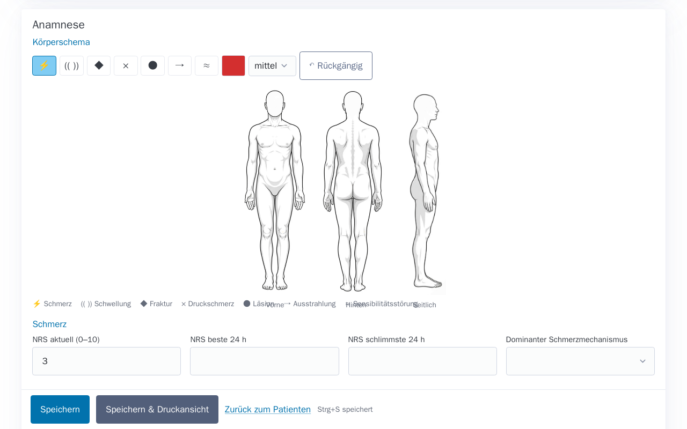

# PhysioBase

A self-hosted knowledge base and documentation tool for physiotherapy. It keeps
conditions, tests, exercises and treatment protocols in one searchable place,
links them to patients and their assessments (Befunde), and prints exercise
handouts and assessment reports.

One static Go binary, one SQLite file, server-rendered pages. The interface is
in German. JavaScript is only used for marking the body chart and a few
conveniences; everything else works without it.


## Features

- **Knowledge base**: conditions, tests/assessments, exercises, treatment
  protocols and notes. Markdown content, tags, body regions, images, videos
  and PDFs, source references, and links between entries.
- **Search**: full text (SQLite FTS5) with prefix matching and diacritics
  folding: `knie` finds *Kniegelenk*, `ubung` finds *Übung*.
- **Exercise handouts**: pick exercises, set dosage and a personal note,
  reorder, copy as a template, print or save as PDF (A4 print view).
- **Patients**: assessments, treatment log, linked knowledge entries and home
  programmes on one page.
- **Assessment form (Befund)**: ICF-oriented and evidence-based, including
  red/yellow flag screening, NRS and pain mechanism, a body chart with symbol
  stamps, ROM/strength/girth tables, special tests, PROMs and performance tests,
  PSFS, differential diagnoses, and plan rationale. Specialty sections
  (orthopaedics, neurology, internal medicine, gynaecology/obstetrics,
  urology, paediatrics) open only when they contain data.
- **Re-assessment and comparison**: start a new assessment as a copy of the
  last one. Compare any two assessments; table rows are matched (for example
  joint and movement) and numeric changes are shown as Δ, including
  Neutral-Null notation (`0-5-100` → `0-0-125` gives `-5 / +25`).
- **Print view**: only filled fields, body chart with legend, optional
  treatment log, signature lines.
- **Import**: JSON exports of the previous standalone assessment page
  (`Befund_*.json`) and of PhysioBase itself.
- **Backups**: consistent SQLite snapshots (`VACUUM INTO`) at start and every
  24 hours, with a configurable number of kept copies.



## Stack

- **Go** standard library, including the `net/http` router and `html/template`
- **SQLite** through [modernc.org/sqlite](https://modernc.org/sqlite) (pure Go, no cgo), FTS5 for search
- **goldmark** for Markdown (raw HTML disabled)
- **bcrypt** from `golang.org/x/crypto`
- **Pico CSS**, vendored; no frontend build step

The form for an assessment is defined once as data in
[`internal/befund/schema.go`](internal/befund/schema.go). The input form,
print view, comparison and import are all generated from it. A new field added
there appears everywhere.

## Running

With the container image:

```sh
cp .env.example .env
echo 'your-password' | podman run --rm -i localhost/physiobase hash-password   # after the first build
# paste the hash into .env
podman compose up -d        # or: docker compose up -d
```

`compose.yml` builds the image, mounts `./data` and publishes port 8080.

From source:

```sh
go build -o physiobase ./cmd/physiobase
echo 'your-password' | ./physiobase hash-password
PHYSIOBASE_USERNAME=admin PHYSIOBASE_PASSWORD_HASH='$2a$12$…' ./physiobase
```

Then open http://localhost:8080. An empty database gets a few sample entries
(tagged *Beispiel*) so the structure is visible. They can be deleted.

### Commands

| Command | Purpose |
|---|---|
| `physiobase` | Start the server |
| `physiobase hash-password` | Read a password from stdin, print its bcrypt hash |
| `physiobase healthcheck` | Exit 0 if `/healthz` answers; used by the container health check |

## Configuration

All configuration is through environment variables. Templates and static files
are embedded in the binary.

| Variable | Default | Purpose |
|---|---|---|
| `PHYSIOBASE_USERNAME` | — | **Required.** Login user |
| `PHYSIOBASE_PASSWORD_HASH` | — | **Required.** bcrypt hash of the password |
| `PHYSIOBASE_PORT` | `8080` | Listen port |
| `PHYSIOBASE_DATA_DIR` | `./data` | Root for everything below |
| `PHYSIOBASE_DB_PATH` | `<data>/physiobase.db` | SQLite database |
| `PHYSIOBASE_MEDIA_DIR` | `<data>/medien` | Uploaded images, videos, PDFs |
| `PHYSIOBASE_BACKUP_DIR` | `<data>/backup` | Daily database backups |
| `PHYSIOBASE_BACKUP_KEEP` | `14` | Backups to keep; `0` turns them off |
| `PHYSIOBASE_PRACTICE_NAME` | `PhysioBase` | Shown in the header and on printouts |
| `PHYSIOBASE_BASE_URL` | — | External URL; an `https://` value makes cookies `Secure` and enables HSTS |
| `PHYSIOBASE_SEED` | `1` | Insert sample entries into an empty database |
| `PHYSIOBASE_LOG_LEVEL` | `info` | `debug`, `info`, `warn` or `error` |
| `PHYSIOBASE_LOG_FORMAT` | `text` | `text` or `json`; logs go to stderr |

The server refuses to start without a username and password hash. There is no
mode without login.

## Security

- Sessions are signed cookies (expiry plus HMAC). Logging out rotates the
  signing secret, which ends every session on every device. Changing the
  password does the same.
- Logins are rate limited: at most two bcrypt checks run at once, and each
  failed attempt waits a second.
- Strict Content Security Policy: no inline scripts or styles, and
  `script-src 'self'`.
- Cross-site POSTs are rejected through Go's `http.CrossOriginProtection`.
- Uploaded files are only served if they belong to an entry in the database.

**Health data:** once real patient data is stored, run it behind HTTPS with
access limited to people who need it. Encryption at rest is not built in
yet; put the data directory on an encrypted volume.

## Data and backups

```
data/
├── physiobase.db        SQLite (WAL mode)
├── medien/              uploads
└── backup/              physiobase-YYYY-MM-DD_HHMMSS.db
```

Do not copy `physiobase.db` while the server runs. In WAL mode, recent writes can
still be in `physiobase.db-wal`. Use the files in `backup/`; each one is a
complete, consistent database.

Restore: stop the server, copy a backup to `physiobase.db`, delete
`physiobase.db-wal` and `physiobase.db-shm`, start again.

## Development

```sh
go test -race ./...
golangci-lint run ./...
gofumpt -l -extra .
```

The same checks, plus `go mod tidy` and `govulncheck`, run in CI on every push
(see [`.hearthforge-ci.toml`](.hearthforge-ci.toml)).

## License

[GNU Affero General Public License v3.0](LICENSE.md). If you run a modified
version as a network service, its users are entitled to the source code.

Bundled third-party files keep their own licenses:
[Pico CSS](https://picocss.com) (`web/static/pico.min.css`) is MIT-licensed.
